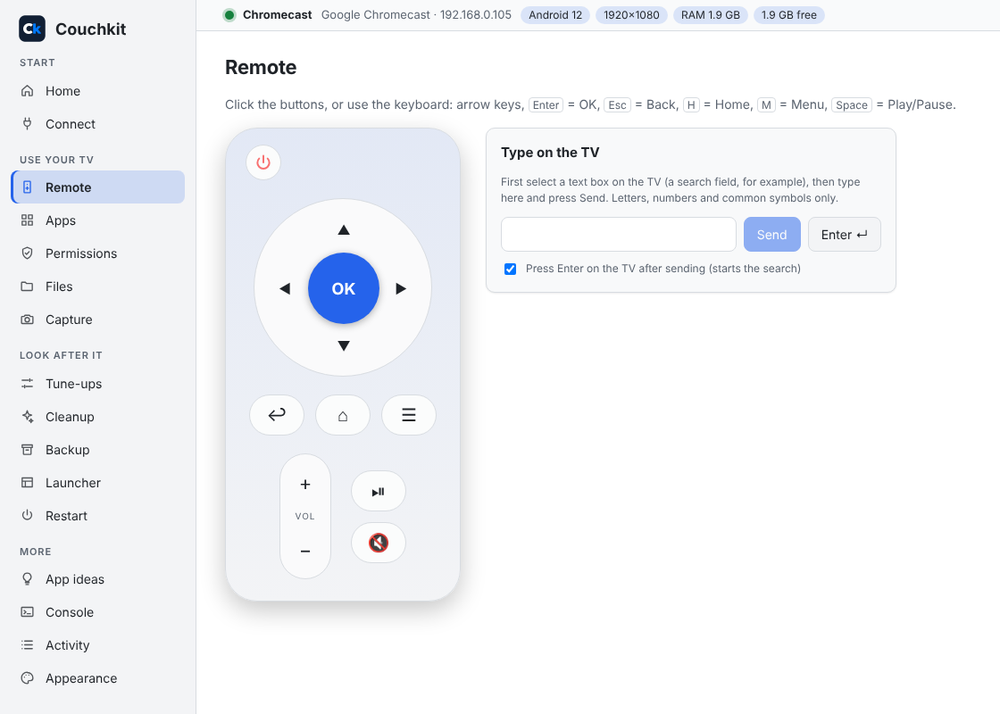
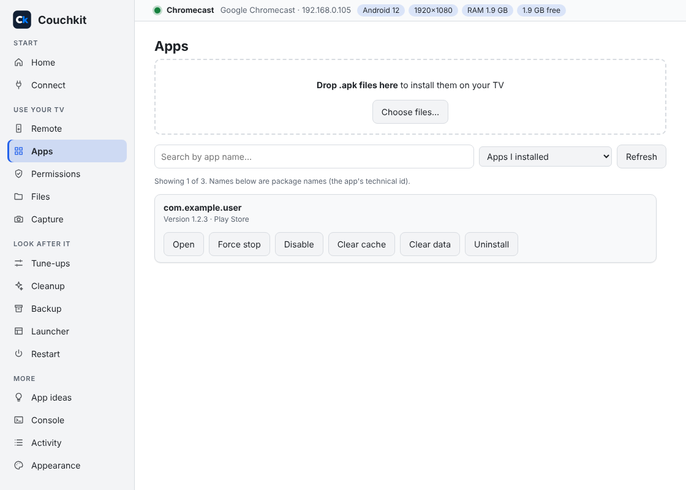
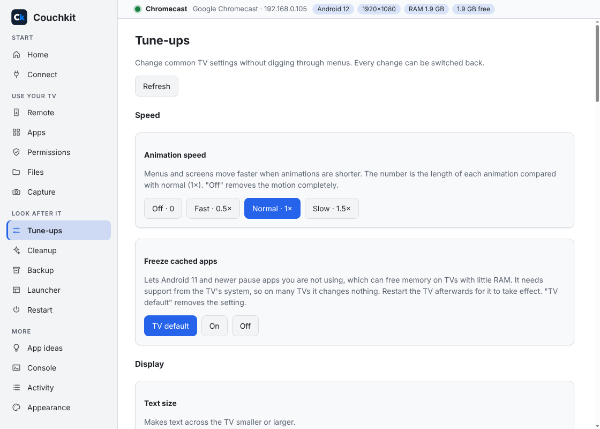

<p align="center">
  
</p>

<h1 align="center">Couchkit</h1>

<p align="center">
  <b>A friendly toolbox for your Google TV or Android TV.</b><br>
  Use your computer as a remote, install apps, move files, take screenshots and tidy up your TV.<br>
  Plain buttons, no commands, no tech knowledge needed.
</p>

<p align="center">
  <a href="../../releases/latest"><b>⬇ Download for Windows or Linux (beta)</b></a> &nbsp;·&nbsp;
  <a href="#get-started">How to get started</a> &nbsp;·&nbsp;
  <a href="#why-couchkit-exists">Why it exists</a>
</p>

<p align="center">
  <a href="../../releases/latest"></a>
  <a href="LICENSE"></a>
  
  
  
</p>

---

## What can it do?

| | |
| --- | --- |
| **Remote** | Control the TV from your keyboard, and type into search boxes the easy way. |
| **Apps** | Install apps by dragging them in. Open, stop, switch off or remove the ones you don't want. |
| **Files** | Send files to the TV and fetch them back. |
| **Capture** | Take screenshots and record the screen. |
| **Tune-ups** | Faster menus, bigger text, a different DNS and more. Every change can be undone. |
| **Cleanup** | Free up space and memory on a slow TV. |
| **Backup** | Save your apps to your computer and restore them later. |
| **Launcher, Restart, Permissions** | Keep your favourite home screen, restart the TV, and choose what each app is allowed to do. |

## See it

<table>
  <tr>
    <td></td>
    <td></td>
    <td></td>
  </tr>
  <tr>
    <td align="center">Remote</td>
    <td align="center">Apps</td>
    <td align="center">Tune-ups</td>
  </tr>
</table>

<sub>Screenshots use a demo TV.</sub>

## Get started

1. **Download it.** Open the **[Releases page](../../releases/latest)** and pick the file for your computer:

   | Your computer | Download | How to use it |
   | --- | --- | --- |
   | **Windows** | `Couchkit-Setup-….exe` | Double-click and follow the steps. |
   | **Windows, no install** | `Couchkit-…-portable.exe` or `Couchkit-…-win.zip` | Portable: just double-click. Zip: unzip anywhere, then run `Couchkit.exe`. |
   | **Linux** (Ubuntu, Debian, Mint) | `couchkit_….deb` | Double-click it, or run `sudo apt install ./couchkit_*.deb`. |
   | **Linux** (other) | `Couchkit-….AppImage` | Allow it to run (right-click > Properties > Allow executing), then double-click. Newer Ubuntu may also need `sudo apt install libfuse2`. |

   **Windows may warn "unknown publisher".** Couchkit isn't code-signed yet (that costs money a free project doesn't have). Press **More info**, then **Run anyway**.

   **Linux is a beta.** It has been tested in a simulated setup but not yet on many real desktops. If something doesn't work, please [tell me](../../issues) with your distribution and version.

2. **Get your TV ready** (once):
   - On the TV open **Settings > System > About** and tap **Build** seven times.
   - Open **Settings > System > Developer options** and turn on **USB debugging** (and **Wireless debugging** if you see it).
   - Keep the TV and your computer on the same Wi-Fi.
3. **Open Couchkit.** It offers to download a small helper tool from Google (called adb) the first time. Then press **Connect**, type your TV's address (or press **Find my TV**), and say yes on the TV when it asks.

That's it. Everything is explained on screen as you go.

**On a Mac?** A Mac installer isn't ready yet. On recent versions of macOS (Sequoia and Tahoe), an installed app can fail to get the "Local Network" permission it needs to find your TV. Couchkit does work on a Mac when run from source (see "For developers" below). A proper Mac download will come once this is solved.

## Why Couchkit exists

I'm not a programmer. I worked with Claude, an AI helper from Anthropic, to create a straightforward, user-friendly utility for my own Android TV because I couldn't find one. I outlined my requirements, Claude wrote the code, and I tested it on my TV until it worked as expected. It's a vibe-coded project, to put it briefly. Despite not being tech savvy, my wife tested it and gave it her approval. 🙂

Because an AI wrote the code, here is what I can tell you honestly: the full source is public, it has automated tests, and it has been used on a real TV. It is also a young project. If something doesn't work, please [tell me](../../issues) and I'll fix it.

## Safe by design

- **No accounts, no tracking, nothing leaves your computer.** Couchkit only talks to your TV, and downloads Google's adb tool when you ask.
- **Risky things are guarded.** Changing the TV's own system apps is marked HIGH RISK, needs a tick to confirm, and the most important ones are locked. Settings that could cause trouble undo themselves after 15 seconds unless you press Keep.
- **Nothing is hidden.** The Activity page shows every command Couchkit runs, if you turn it on.

## Support the project

Couchkit is free. If it saved you some time, you can [buy me a coffee](https://buymeacoffee.com/vistrocity). It's optional, and the app is the same either way.

## For developers

Needs [Node.js](https://nodejs.org) 22 or newer.

```bash
npm install
npm run dev    # run the app
npm test
npm run dist   # build an installer for your system
```

Built with Electron, TypeScript and React. See [CONTRIBUTING.md](CONTRIBUTING.md).

## Licence and credit

Created by **Steve Rozario**. Free and open source under the [Apache License 2.0](LICENSE). Copyright 2026 Steve Rozario.
If you share or modify it, keep the copyright notice and the [NOTICE](NOTICE) file. The Couchkit name and logo are not part of the licence ([TRADEMARKS.md](TRADEMARKS.md)).

Couchkit is an independent project, not affiliated with or endorsed by Google. "Android" and "Google TV" are trademarks of Google LLC. `adb` is a separate Google program with its own licence and is not included.
